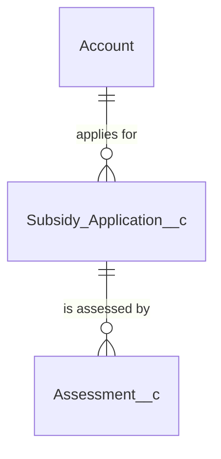
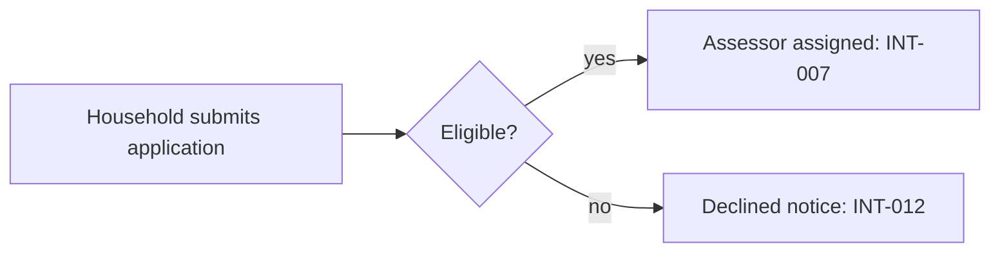

# The data model and the solution overview

Two living files describe the whole build, where each intent's `design.md` describes one piece (decisions/0103). Neither is ratified on its own: each is accepted in the pull request that changes it, like `launchpad/systems.md`. Diagrams are Mermaid in the markdown, so a reviewer reads the change in the diff and the next design can edit it. An image or an external diagram link may sit beside one as a supplement, never in its place.

The **data model describes only what's merged to the integration line: the branch build PRs target (`develop` on the full pipeline, else `main`, or the default branch with no deploy pipeline).** The solution overview describes the engagement's planned solution, built or not. A design edits either file only on its intent's feature branch, so an intent that's cut or reworked before merge leaves nothing behind; on any other branch, it leaves both to the build branch and says so. A shape that's designed but not built yet stays in its `design.md`. Ingest and the ps-engagement on-ramp draft in their own pull requests.

## `launchpad/data-model.md` (the org's data model)

One file for the org, shared by every engagement in the repo. It covers the objects this repo's work creates or changes, plus the existing objects they relate to. It never lists the rest of the org: for an existing object, point at its `launchpad/org-inventory.md#<object>` entry instead of restating its fields.

~~~markdown
# Data model

The objects this repo's work creates or changes and how they relate. Living: each design that changes it edits it in the same pull request. Existing objects point at the org inventory.

## Diagrams

### Applications

## Subsidy_Application__c
Custom. One per application a household submits. Master-detail to Account (an application never outlives its household). Key fields: Status__c (picklist), Submitted_On__c (date). Created by acme-2026/INT-003; Status__c extended by acme-2026/INT-009.

## Account
Standard, existing: `org-inventory.md#account`. This build adds the Subsidy_Application__c relationship and Household_Size__c (acme-2026/INT-003).
~~~

- **One `## <API name>` section per object**, with: standard or custom, and new or existing; what one record is, in a sentence; each relationship with its type and the reason for it; the key fields this work adds or relies on; and the intents that created or changed it, written `<slug>/INT-NNN` since every engagement shares the file. Field-level detail beyond the key fields belongs in the metadata, not here.
- **One `erDiagram` per area under `## Diagrams`**, never one for the whole org: two intents built in parallel then edit different blocks instead of conflicting in one. The object sections are the record; a diagram is a view of their relationships.
- No sharing, permission sets or automation: those live in each design and in the personas.

## `launchpad/engagements/<slug>/solution.md` (the solution overview)

One file per engagement: the whole solution as a builder reads it.

~~~markdown
# Solution overview

What this engagement builds and how the pieces fit. Living: each design that changes a flow edits it in the same pull request. The standing premises it builds on are in `launchpad/decisions/architecture/`; the data model is in `launchpad/data-model.md`.

## What it delivers
<a short paragraph per capability, in business language, naming the intents that build it>

## How it fits together
<the clouds and major components, the external systems by `launchpad/systems.md#<slug>`, and the standing premises that shape them, linked, never restated>

## Process flows

### <flow name>
<one sentence: who starts it, what ends it>

~~~

- **A flow earns its place by crossing intents.** One that lives inside a single intent belongs in that intent's design. Name the intent at each step it owns.
- **No principles section.** Link the standing premises; restating them makes a second copy that drifts. With none adopted yet, describe the architecture plainly and never call the overview a record of premises: name each candidate premise in your summary for the Trusted Guide to adopt as an architecture decision (`launchpad/decisions/architecture/`), where designs are held to it.

### Drafting it from a source

Ingest drafts the overview from a Scopezilla project's solution document, and the ps-engagement on-ramp from that template's design folder. Both sources were written to sell the solution, and the overview describes the build. So the dirty-source membrane (AGENTS.md) applies to every line: write in your own words, never a quote, and leave out sizes, estimates, prices, value claims, named people and citation tags pointing into the source.

You read the source, so you can't judge whether the draft leaked it. Before the file lands, run the independent scrub `/ql-refine-intent` defines in its grill (Step G5), giving the reader only `solution.md`, and resolve every finding.

## Creating either file

On first use, write the heading and the one-line description shown above, then the sections the current work supports. Don't invent sections nothing yet fills.
