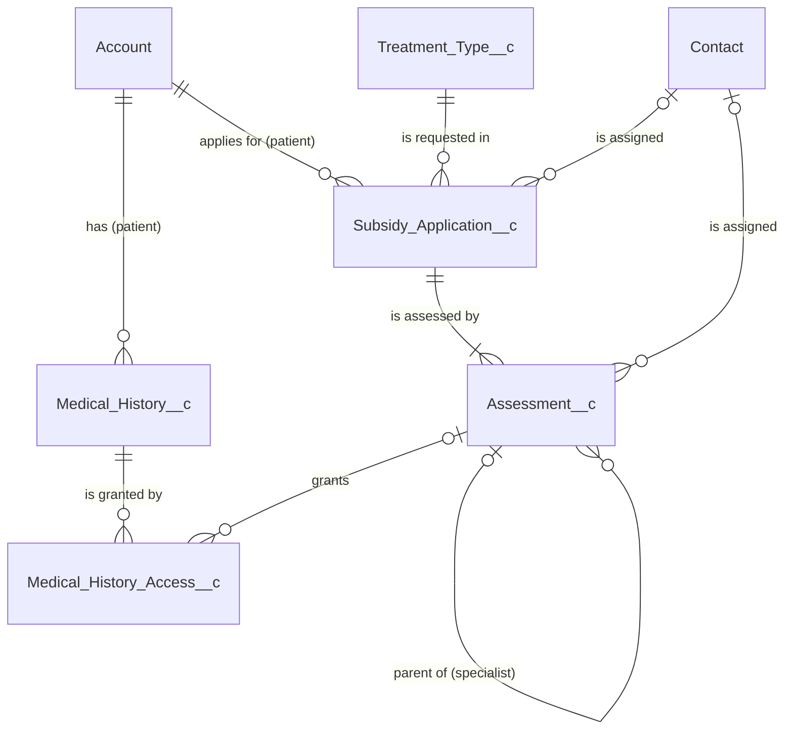
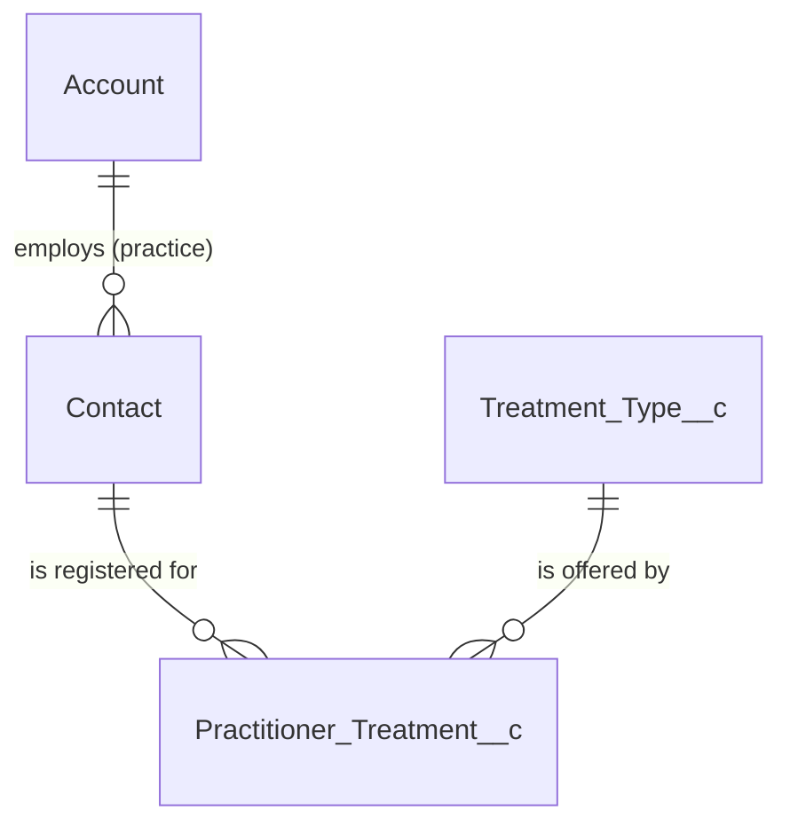

# Data model

The objects this repo's work creates or changes and how they relate. Living: each design that changes it edits it in the same pull request. Existing objects point at the org inventory.

## Diagrams

### Patients, applications and medical history

### Practices, practitioners and treatment types

## Account
Standard, existing: `org-inventory.md#account`. Patients are person accounts (record type `PersonAccount`); practices are business accounts (record type `Business_Account`). This build adds the `Patient_Reference__c` External ID, the patient's indexed search and migration key (ptsf-lab/INT-001).

## Contact
Standard, existing: `org-inventory.md#contact`. A medical practitioner under their practice's business account (ptsf-lab/INT-001).

## Subsidy_Application__c
Custom, new. One travel-subsidy request by a patient. Lookup (required) to the patient Account, so it keeps its own owner, queues and sharing; lookups to `Treatment_Type__c` and to the assigned practitioner (Contact). Key fields: `Status__c`, `Reason__c`, `Insurance_Check_Result__c` (placeholder picklists), `Approved_Amount__c` (currency), `Satellite_Office__c`, `Region__c` (placeholder picklists). Created by ptsf-lab/INT-001.

## Assessment__c
Custom, new. One practitioner's assessment of an application. Master-detail to `Subsidy_Application__c`, so whoever sees the application sees its assessments; self-lookup `Parent_Assessment__c` for specialist requests; lookup to the assigned practitioner (Contact). Key fields: `Status__c` (placeholder picklist), `Assigned_Date__c` (date/time). No roll-up summaries, so a later conversion to lookup stays open. Created by ptsf-lab/INT-001.

## Medical_History__c
Custom, new. A patient's medical history, held apart from the patient and the application. Lookup (required) to the patient Account, never master-detail, so it keeps its own share object for record-by-record grants. Key field: `Details__c` (long text, interim). Created by ptsf-lab/INT-001.

## Medical_History_Access__c
Custom, new. One time-bound grant of medical-history access. Lookups to `Medical_History__c` (deletion of the history restricted), the patient Account, `Assessment__c` and the grantee User (`Granted_To__c`). Key fields: `Granted_At__c`, `Revoked_At__c` (date/time). Created by ptsf-lab/INT-001.

## Treatment_Type__c
Custom, new. One entry in the treatment-type catalog (500+). Key fields: `Code__c` (unique External ID), `Active__c`. Created by ptsf-lab/INT-001.

## Practitioner_Treatment__c
Custom, new. Junction: a practitioner registered for a treatment type. Master-detail to Contact (primary) and to `Treatment_Type__c`; the allocation filter runs on its Treatment Type link. Created by ptsf-lab/INT-001.

## Subsidy_Rate__mdt
Custom metadata type, new. A guidance rate for one transport type and distance band, edited in Setup without deployment. Key fields: `Transport_Type__c`, `Distance_Band__c`, `Rate__c`. Created by ptsf-lab/INT-001.
