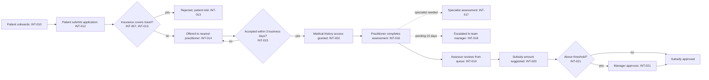
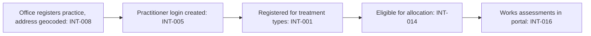

# Solution overview

What this engagement builds and how the pieces fit. Living: each design that changes a flow edits it in the same pull request. The standing premises it builds on are in `decisions/architecture/`; the data model is in `launchpad/data-model.md`.

## What it delivers

**Data model and medical-history protection.** One global model for patients, practices, practitioners, subsidy applications, assessments and medical history, sized for very large patient volumes. Medical history sits on its own private object. Practitioners get time-bound access only while they hold an open assigned assessment, and internal business users get none. INT-001, INT-002, INT-003.

**Identity.** Patients sign themselves up with email or a social login. PTSF creates practitioner logins. Staff sign in through their own regional directory. INT-004, INT-005, INT-006.

**Integrations.** A background health-insurance check with retry, and address validation with geocoding. INT-007, INT-008.

**Patient onboarding.** A guided onboarding wizard on the patient portal, prefilled from the insurer and address-validated, followed by a welcome email in the patient's language. Applications stay locked until onboarding is complete. INT-010, INT-011.

**Application and eligibility.** The patient picks a treatment type, gives a reason and confirms their medical history. Applications whose insurance already covers travel are rejected automatically. INT-012, INT-013.

**Practitioner allocation.** Each application is offered to the nearest practitioner registered for its treatment type. It is reassigned on decline or after three business days. INT-014, INT-015.

**Practitioner assessment.** A practitioner portal with a work list and a digital assessment form. Practitioners can request specialist assessments, and assessments still pending after fifteen days escalate to a team manager. INT-016, INT-017, INT-018.

**Review and approval.** Assessors work regional and office queues in the service console. The system suggests a subsidy amount from distance and transport type, and higher-value subsidies go to a manager for approval. INT-019, INT-020, INT-021.

**Chat and self-service.** Chat with an assessor from both portals, plus a searchable help centre. INT-022, INT-023.

**Release, migration and non-production data.** Environments with a source-driven release pipeline, migration readiness and a pilot-office load with reconciliation, and masked medical history in non-production environments. INT-009, INT-024, INT-025, INT-026.

## How it fits together

- **One org on the core platform**, with no industry cloud: [ADR 0002](decisions/architecture/0002-core-platform-no-industry-cloud.md).
- **Experience Cloud** runs two portals on the Lightning Web Runtime: one for patients, one for practitioners. Patients are person accounts. Practitioners are contacts under their practice's business account.
- **Service Cloud** gives assessors and managers the console, queue routing, chat and the knowledge base.
- **Medical history** stays in this org, behind field-level security for internal users, per-assessment grants for practitioners, and monitored break-glass access for administrators: [ADR 0001](decisions/architecture/0001-medical-history-in-org-governed.md).
- **Integrations** are direct callouts through Named Credentials, with no middleware. They cover the health-insurance checker, an address validation and geocoding service, and a high-volume email channel. None of these systems has an entry in `launchpad/systems.md` yet; the provider for the address service and the email channel is still open.
- **Migration** brings data in from the legacy case-management system, one office at a time, through a staging area.

## Process flows

### Patient application to subsidy decision

Starts when an onboarded patient submits an application. Ends when the subsidy is approved, or the application is rejected.

### Practitioner onboarding to first assessment

Starts when PTSF registers a practitioner. Ends when the practitioner can work allocated assessments.

